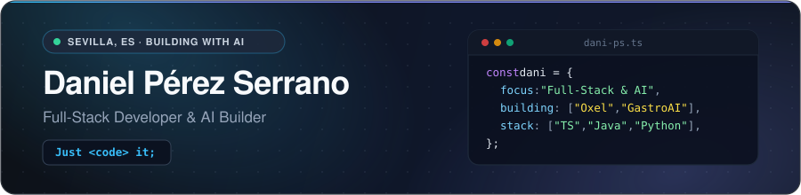

  <picture>
    <source media="(prefers-color-scheme: dark)" srcset="./images/banner-dark.svg" />
    <source media="(prefers-color-scheme: light)" srcset="./images/banner-light.svg" />
    
  </picture>

   
   

  
  &nbsp;
  
  &nbsp;
  
  &nbsp;
  

 

### 👋 Sobre mí

Soy **Daniel Pérez Serrano**, desarrollador **Full-Stack** y **AI Builder** desde Sevilla. Construyo productos digitales de extremo a extremo combinando **TypeScript / React / Next.js**, **Java / Spring Boot** y **Python**, con foco especial en **IA aplicada, agentes y automatización**.

Me importa llevar las ideas hasta producción con buena arquitectura, interfaces limpias y soluciones que resuelvan problemas reales.

---

### 🚀 En qué estoy trabajando

- ⚡ **Construyendo [Oxel](https://oxel.app) ([@oxelos](https://github.com/oxelos))** — SaaS para hostelería en España sobre arquitectura monorepo (`Turborepo` + `pnpm`) con **Cloudflare Workers**, **Hono** y **Supabase**.
- 🍽️ **Desarrollando [GastroAI](https://gastroai.es)** — plataforma SaaS con IA para restaurantes: cartas digitales, gestión de reservas, panel de control y atención automatizada omnicanal.
- 🤖 **Agentes de IA & Developer Tooling** — diseño de flujos con LLMs (cloud y modelos locales), servidores **MCP** y herramientas internas para acelerar el desarrollo de software.

---

### 🧩 Proyectos destacados

<table>
  <tr>
    <td width="50%" valign="top">
      <h4>⚡ <a href="https://oxel.app">Oxel</a> &nbsp;<code>Building</code></h4>
      
SaaS para propietarios de bares y restaurantes en España (<a href="https://github.com/oxelos">@oxelos</a>). Monorepo full-stack con dashboard, consola operativa, API en el edge y diseño de dominio compartido.

      

        <code>TypeScript</code> <code>Turborepo</code> <code>Hono</code> <code>Cloudflare Workers</code> <code>Supabase</code>
      

    </td>
    <td width="50%" valign="top">
      <h4>🍽️ <a href="https://gastroai.es">GastroAI</a> &nbsp;<code>Producción</code></h4>
      
Plataforma inteligente para restaurantes que une cartas digitales interactivas, reservas, analítica y automatización con IA (WhatsApp / Meta).

      

        <code>Next.js</code> <code>TypeScript</code> <code>AI</code> <code>Cloudflare</code>
      

    </td>
  </tr>
  <tr>
    <td width="50%" valign="top">
      <h4>🌱 <a href="https://github.com/Dani-Ps/Redeemed">Redeemed</a> &nbsp;<code>Open Source</code></h4>
      
Aplicación web <em>mobile-first</em> de bienestar emocional y reflexión diaria, <em>private by design</em> (100% local con <code>IndexedDB</code>, sin tracking ni servidores).

      

        <code>React 19</code> <code>TypeScript</code> <code>Vite 7</code> <code>Tailwind 4</code>
      

    </td>
    <td width="50%" valign="top">
      <h4>☕ <a href="https://github.com/Dani-Ps/ms-example">ms-example</a> &nbsp;<code>Open Source</code></h4>
      
Plantilla base para construir microservicios desde cero en el ecosistema Java moderno, pensada como punto de partida limpio y extensible.

      

        <code>Java 21</code> <code>Spring Boot</code> <code>Maven</code>
      

    </td>
  </tr>
</table>

---

### 🛠️ Stack principal

   
  <picture>
    <source media="(prefers-color-scheme: dark)" srcset="https://skillicons.dev/icons?i=ts,react,nextjs,vite,tailwind,java,spring,py,nodejs,supabase,cloudflare,docker,vercel,git&perline=7&theme=dark" />
    <source media="(prefers-color-scheme: light)" srcset="https://skillicons.dev/icons?i=ts,react,nextjs,vite,tailwind,java,spring,py,nodejs,supabase,cloudflare,docker,vercel,git&perline=7&theme=light" />
    
  </picture>

 

| Área | Tecnologías |
| :--- | :--- |
| **Frontend** | TypeScript, React 19, Next.js, Vite, Tailwind CSS |
| **Backend & Data** | Hono, Cloudflare Workers, Supabase, Java 21, Spring Boot, Node.js, Python |
| **IA & Automatización** | LLMs (cloud & locales), Agentes de IA, MCP, n8n |
| **Infraestructura & QA** | Turborepo, Docker, Vercel, Cloudflare, Playwright, Linux, Git |

---

  ¿Hablamos de producto, arquitectura o IA aplicada? Encuéntrame en <a href="https://www.linkedin.com/in/dani-ps">LinkedIn</a> o escríbeme a <a href="mailto:daniperez439@gmail.com">daniperez439@gmail.com</a>.

